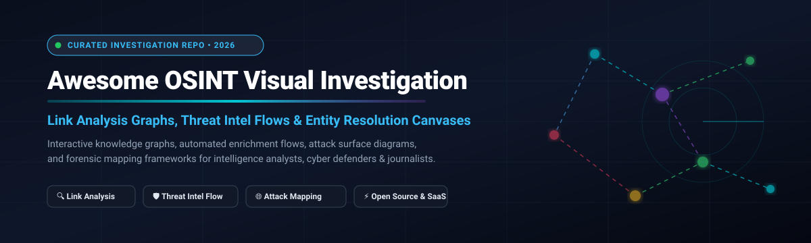
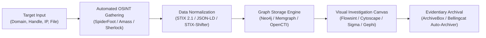

# 🔍 Awesome OSINT Visual Investigation & Flow Diagrams 🌐

  <b>A curated catalog of elite SaaS investigation suites and open-source visual link-analysis tools, interactive graph canvases, threat intelligence enrichment pipelines, and attack surface flow diagrams.</b>

---

## 📑 Table of Contents
- [🎯 Overview & Purpose](#-overview--purpose)
- [📊 Sector Overview & Market Dynamics](#-sector-overview--market-dynamics)
- [💼 SaaS & Commercial Hosted Platforms](#-saas--commercial-hosted-platforms)
- [🔓 Open-Source GitHub Projects](#-open-source-github-projects)
- [🚀 Architecture & Integration Pipelines](#-architecture--integration-pipelines)
- [☕ Support & Sponsoring](#-support--sponsoring)
- [🤝 How to Contribute](#-how-to-contribute)
- [📈 Star History](#-star-history)
- [⚠️ Disclaimer & Ethical Guidance](#-disclaimer--ethical-guidance)

---

## 🎯 Overview & Purpose

In open-source intelligence (OSINT), threat investigation, and cyber defense, **data is only as powerful as your ability to connect the dots**. Raw indicators, IP records, leaked credentials, social identifiers, corporate registries, and DNS records quickly overwhelm traditional tabular views. 

**Visual investigation and flow diagrams** empower researchers, threat hunters, law enforcement agencies, and investigative journalists to:
- 🕸️ **Map complex entity relationships** (person-to-infrastructure, domain-to-malware, crypto-to-fiat).
- 🔄 **Execute automated transforms and recursive lookups** directly on an interactive canvas.
- ⚡ **Detect hidden paths, central nodes, and lateral escalation patterns** using topological graph theory.
- 🛡️ **Preserve chain of custody and provenance flows** for actionable reporting and evidentiary audits.

This repository tracks both battle-tested commercial SaaS products and top-tier open-source tools driving modern visual intelligence.

---

## 📊 Sector Overview & Market Dynamics

The global market for visual investigation software, link analysis, and OSINT threat intelligence was valued at approximately **$8.2 billion in 2024–2025** and is projected to surpass **$18.5 billion by 2032**, expanding at a compound annual growth rate (CAGR) of over **11.4%**.

Market dynamics in this sector reflect **moderate fragmentation** characterized by specialized sub-niches:
- **Defense, Government, & Enterprise Giants**: Mega-cap incumbents (Palantir, IBM i2) dominate large-scale multi-million dollar defense and sovereign intelligence contracts.
- **Specialized OSINT & Graph Innovation**: Mid-tier and high-growth vendors (Maltego, Cambridge Intelligence, Linkurious, Siren, DataWalk) compete fiercely on visual usability, API integrations, and developer SDK ecosystems.
- **Open-Source Resilience**: Because investigative workloads require high privacy, OPSEC, and custom data ingestion, open-source knowledge graph platforms (OpenCTI, MISP, SpiderFoot, BloodHound) hold an irreplaceable footprint among independent researchers and security operations centers (SOCs).

---

## 💼 SaaS & Commercial Hosted Platforms

The table below catalogs premier commercial platforms for visual investigation and threat intelligence link analysis, ranked in **descending order by company revenue / valuation**.

| Platform | Revenue / Valuation | Starting Tier Pricing | Free Tier / Free Trial Limits | Key Capabilities |
| :--- | :--- | :--- | :--- | :--- |
| **[Palantir Foundry & Gotham](https://palantir.com)** | **~$120 Billion** Valuation (Public: PLTR, ~$2.8B Annual Rev) | Starting at **$3,500/month** (via AWS/Azure Marketplace Foundry pay-as-you-go instances) | **30-day guided free trial** (up to 5 enterprise user seats with $500 cloud usage credit) | Enterprise data integration, ontology modeling, and high-dimensional investigative link graphs for government and enterprise defense. |
| **[IBM i2 Analyst's Notebook](https://ibm.com)** | **~$190 Billion** Market Cap (IBM Corp; i2 Group div. ~$80M ARR) | Starting at **$2,860/seat/year** (Standard desktop perpetual/term license via authorized reseller) | **30-day fully functional desktop trial** (1 named workstation seat, local storage only) | The gold standard in visual criminal network analysis, phone record toll analysis, timeline mapping, and forensic link charts. |
| **[Neo4j Bloom](https://neo4j.com)** | **~$2.5 Billion** Valuation (~$180M ARR) | Starting at **$65/month** (Neo4j AuraDB Professional, includes Bloom visual search) | **Free forever plan** (Neo4j AuraDB Free includes Bloom exploration for 1 graph database up to 200k nodes and 400k relationships) | Codeless visual graph exploration and natural language search engine built directly natively atop Neo4j graph databases. |
| **[Maltego](https://maltego.com)** | **~$350 Million** Valuation (Acquired by Charlesbank Capital; ~$30M ARR) | Starting at **$999/user/year** (Maltego Classic license) | **Free forever tier (Community Edition)**: Limited to 12 results per transform query, manual mapping, non-commercial use only. | Industry-defining visual OSINT canvas connecting entities via thousands of turnkey automated hub data transforms. |
| **[DataWalk](https://datawalk.com)** | **~$120 Million** Market Cap (Warsaw: DAT; ~$12M ARR) | Starting at **$15,000/server instance/year** (Entry enterprise deployment) | **14-day assisted enterprise pilot sandbox** (capped at 1 dataset sandbox up to 500,000 entities) | Massively scalable intelligence analysis platform combining link analysis, automated pattern scoring, and knowledge graph fusion. |
| **[Linkurious Enterprise](https://linkurious.com)** | **~$45 Million** Valuation (~$8M ARR) | Starting at **$690/analyst/month** (Team Server Tier) | **30-day free trial** (Team Sandbox instance supporting up to 3 named investigators and 1 external graph connection) | Real-time graph analytics and interactive link visualization engine engineered for anti-money laundering (AML), fraud, and SOC investigations. |
| **[Siren Investigative Platform](https://siren.io)** | **~$40 Million** Valuation (~$6M ARR) | Starting at **$1,500/month** (Siren Business Server Edition) | **30-day Community/Trial edition** (full feature set restricted to single-node Elasticsearch/OpenSearch clusters up to 10M records) | Search-driven intelligence platform uniting relational search, interactive graph link diagrams, and big-data dashboard correlations. |
| **[KeyLines & ReGraph (Cambridge Intelligence)](https://cambridge-intelligence.com)** | **~$35 Million** Valuation (~$7M ARR) | Starting at **$1,400/developer/month** (Billed annually for commercial SDK deployment license) | **30-day full SDK trial** (access to complete API documentation, code sandboxes, and developer support for up to 2 developers) | High-performance React and JavaScript graph visualization toolkits used by global defense developers to build bespoke visual flow tools. |
| **[SpiderFoot HX](https://spiderfoot.net)** | **~$15 Million** Valuation (SpiderFoot Project / Intel471) | Starting at **$79/month** (Freelancer Tier) | **14-day free trial** (includes 50 automated scan credits, 25 investigative targets, and standard node-graph exports) | Cloud-hosted OSINT automation platform executing recursive threat lookups with interactive force-directed relationship maps. |
| **[ShadowDragon](https://shadowdragon.io)** | **~$12 Million** Valuation (~$4M ARR) | Starting at **$5,000/analyst/year** (SocialNet Core subscription) | **7-day vetted trial** (limited to certified law enforcement, intelligence, and vetted corporate security professionals) | Deep social media intelligence, dark web footprint tracking, and persona mapping with direct visualization flow connectors. |

---

## 🔓 Open-Source GitHub Projects

Explore the most powerful open-source graph frameworks, reconnaissance tools, and investigative flow canvases. **Ranked in descending order by GitHub stargazers**:

| Repository | GitHub Stars | Core OSINT & Flow Visual Specialization |
| :--- | :---: | :--- |
| **[excalidraw/excalidraw](https://github.com/excalidraw/excalidraw)** |  | 🎨 Virtual hand-drawn whiteboard canvas widely used by investigators for sketching attack flows, sock-puppet infrastructure, and visual timelines. |
| **[sherlock-project/sherlock](https://github.com/sherlock-project/sherlock)** |  | 🔎 High-speed multi-platform social media username hunter that surfaces cross-platform digital footprints for entity graph mapping. |
| **[mermaid-js/mermaid](https://github.com/mermaid-js/mermaid)** |  | 📊 Markdown-driven diagramming and charting tool ideal for rendering automated investigation trees, sequence flows, and attack path reports. |
| **[soxoj/maigret](https://github.com/soxoj/maigret)** |  | 👤 Powerful username OSINT reconnaissance engine generating detailed dossier reports with recursive visual link diagrams. |
| **[xyflow/xyflow](https://github.com/xyflow/xyflow)** |  | 🧩 Foundational React Flow and Svelte Flow libraries for engineering custom interactive node-based OSINT transform pipelines and canvas UIs. |
| **[ArchiveBox/ArchiveBox](https://github.com/ArchiveBox/ArchiveBox)** |  | 🗄️ Self-hosted internet archiving solution preserving investigative web evidence, screenshots, and source HTML with full cryptographic integrity. |
| **[smicallef/spiderfoot](https://github.com/smicallef/spiderfoot)** |  | 🕷️ Iconic open-source OSINT automation framework querying 200+ public sources with integrated D3 force-directed relationship graphs. |
| **[neo4j/neo4j](https://github.com/neo4j/neo4j)** |  | 🗃️ The world-leading open-source native property graph database powering high-performance Cypher-queried entity resolution workflows. |
| **[owasp-amass/amass](https://github.com/owasp-amass/amass)** |  | 🌐 In-depth attack surface mapping and asset discovery engine with an embedded graph database (`OAM`) and network graph topology exports. |
| **[jacomyal/sigma.js](https://github.com/jacomyal/sigma.js)** |  | ⚡ WebGL-powered JavaScript library specialized in rendering massive interactive network graphs in browser-based investigation interfaces. |
| **[cytoscape/cytoscape.js](https://github.com/cytoscape/cytoscape.js)** |  | 📈 Industry-standard graph theory and link-analysis visualization engine for network diagrams, entity resolution, and algorithmic clustering. |
| **[OpenCTI-Platform/opencti](https://github.com/OpenCTI-Platform/opencti)** |  | 🛡️ Leading open-source cyber threat intelligence and knowledge graph platform built on STIX 2.1 with interactive entity diagrams. |
| **[reconurge/flowsint](https://github.com/reconurge/flowsint)** |  | 🌊 Modern open-source visual OSINT investigation canvas combining node-graph flows with modular automated reconnaissance pipelines. |
| **[gephi/gephi](https://github.com/gephi/gephi)** |  | 🔬 Premier desktop network analysis and exploration application used to uncover communities and key bridge entities in massive datasets. |
| **[MISP/MISP](https://github.com/MISP/MISP)** |  | 🚨 Open-source threat sharing platform featuring built-in correlation graphs, indicator clustering, and visual cyber timeline maps. |
| **[lanmaster53/recon-ng](https://github.com/lanmaster53/recon-ng)** |  | 🧰 Full-featured Python reconnaissance framework with database-backed entity tracking, modular analyzers, and CSV/visual reporting. |
| **[intelowlproject/intelowl](https://github.com/intelowlproject/intelowl)** |  | 🦉 Unified threat intelligence orchestration platform running 150+ automated analyzers with visual relationship graphing in single API/UI. |
| **[memgraph/memgraph](https://github.com/memgraph/memgraph)** |  | ⚡ High-performance in-memory graph database compatible with Cypher and Neo4j drivers for sub-millisecond link traversal queries. |
| **[SpecterOps/BloodHound](https://github.com/SpecterOps/BloodHound)** |  | 🩸 Graph-theory-driven active directory and cloud attack path visualizer mapping hidden privilege escalation routes. |
| **[graphistry/pygraphistry](https://github.com/graphistry/pygraphistry)** |  | 🚀 GPU-accelerated visual graph analytics library connecting Python dataframes (Pandas/Polars) directly into interactive WebGL charts. |
| **[alephdata/aleph](https://github.com/alephdata/aleph)** |  | 📰 OCCRP's flagship investigative software cross-referencing massive document leaks, public records, and criminal entity networks. |
| **[yeti-platform/yeti](https://github.com/yeti-platform/yeti)** |  | 🏔️ Threat intelligence repository for organizing observables, TTPs, and indicators of compromise into interactive investigative trees. |
| **[bellingcat/auto-archiver](https://github.com/bellingcat/auto-archiver)** |  | 📹 Bellingcat's automated media and social evidence preservation engine for verifiable OSINT investigations. |

---

## 🚀 Architecture & Integration Pipelines

A robust, self-hosted visual OSINT pipeline often integrates several layers:

---

## ☕ Support & Sponsoring

If you find this curated collection and research useful for your investigations, cyber defense work, or tooling:
- ⭐ **Star this repository** to help others discover it!
- 🍴 **Fork and share** with your network, team, or investigative peers.
- ☕ **Support continuous updates & development**: Buy me a coffee via the [GitHub Sponsor Dashboard](https://github.com/sponsors/ishandutta2007).

---

## 🤝 How to Contribute

We welcome contributions from the OSINT, threat intelligence, and graph visualization communities!
1. 🍴 **Fork the repository**.
2. 🌿 **Create your feature branch** (`git checkout -b feature/new-osint-tool`).
3. 📝 **Add or edit entries**:
   - Provide the tool name, verified GitHub repository link, official documentation/site, and an objective 1–2 sentence description.
   - For SaaS products: include verified starting price, free tier or trial specifications, and estimated valuation/revenue.
   - For open-source tools: include the standard social star badge linking to the stargazers page.
4. 🚀 **Submit a Pull Request** with a concise summary of the addition.

---

## 📈 Star History

#

---

## ⚠️ Disclaimer & Ethical Guidance

- **Community Curation**: This repository is a community-maintained resource and does not constitute formal endorsement of any listed tool or platform.
- **Legal Compliance**: OSINT workflows, passive reconnaissance, and graph modeling must comply strictly with applicable international, national, and local privacy legislation (e.g., GDPR, CCPA, DPDP Act), terms of service, and authorization boundaries.
- **Operational Security (OPSEC)**: Always route investigative queries through isolated virtual machines, dedicated research personas, VPNs/proxies, and encrypted storage containers to prevent operational blowback and protect source confidentiality.

---

  <b>Built with care for open-source intelligence researchers, incident responders, and visual investigators worldwide. 🌐✨</b>

